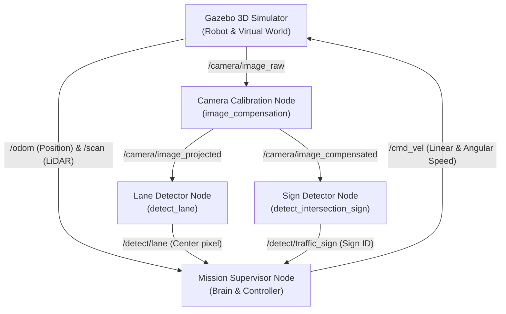
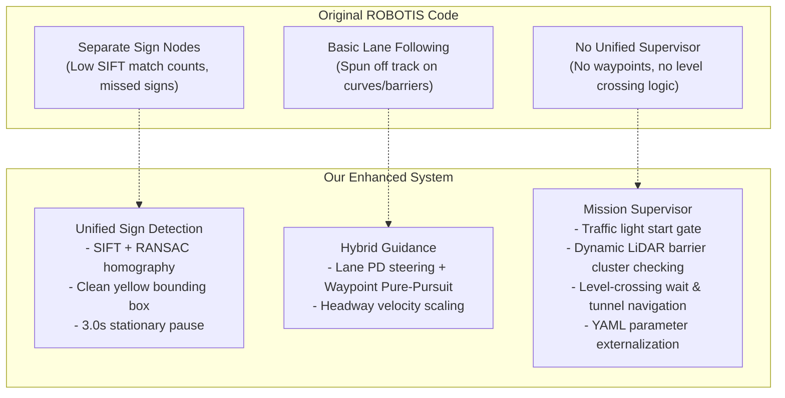

# TurtleBot3 AutoRace 2020 — Complete Zero-to-Hero Beginner's Guide

Welcome! This guide explains **everything from absolute zero**—designed so anyone, even without prior ROS 2, Gazebo, or computer vision experience, can understand how the robot operates, how to reproduce it, and how to customize it.

---

## 📑 Table of Contents
1. [Core Concepts: What is ROS 2?](#1-core-concepts-what-is-ros-2)
2. [Simulation & Environment: Gazebo and Docker](#2-simulation--environment-gazebo-and-docker)
3. [Original ROBOTIS Repo vs. Our Enhancements](#3-original-robotis-repo-vs-our-enhancements)
4. [How the Robot Operates (Step-by-Step Architecture)](#4-how-the-robot-operates-step-by-step-architecture)
5. [The Two Simulation Modes](#5-the-two-simulation-modes)
6. [How to Reproduce & Run Everything](#6-how-to-reproduce--run-everything)
7. [Tuning, Customizing, & Debugging](#7-tuning-customizing--debugging)

---

## 1. Core Concepts: What is ROS 2?

### 1.1 The Concept of Nodes and Topics
**ROS 2 (Robot Operating System 2)** is not an operating system like Linux or Windows. It is a **robotics middleware**—a communication framework that lets small independent programs communicate over a local network.

In standard programming, you might write a single large Python file that reads sensor values, computes physics, processes images, and controls motors. In ROS 2, tasks are decoupled into **Nodes**:



### 1.2 Five Key Building Blocks

| Concept | What It Does | Concrete Example in This Project |
| :--- | :--- | :--- |
| **Node** | An individual executable process running one task. | `detect_intersection_sign.py` — dedicated purely to traffic sign template matching. |
| **Topic** | A named broadcast channel with a publish/subscribe model. | `/cmd_vel` — topic on which speed and turn commands are published to the robot wheels. |
| **Message** | The strict data structure transmitted over a topic. | `geometry_msgs/Twist` (`linear.x`, `angular.z`), `sensor_msgs/LaserScan`. |
| **Parameter** | Tunable configuration key-value pairs loaded at startup. | `course_2020.yaml` — defines sign pause seconds (`3.0s`), speeds, and waypoints. |
| **Launch File** | A Python script that orchestrates and starts multiple nodes together. | `control_race.launch.py` — starts lane tracking, supervisor, and MP4 recorder. |

---

## 2. Simulation & Environment: Gazebo and Docker

### 2.1 Gazebo Classic 11
- **Physics Simulation**: Simulates rigid-body dynamics, wheel friction, inertia, gravity, and collisions.
- **Sensors**: Simulates the 360° 2D LiDAR scanner (`/scan`), differential drive odometry (`/odom`), and the front fisheye camera (`/camera/image_raw`).
- **World**: The `turtlebot3_autorace_2020.world` model provides the 4m × 4m track surface, lane markings, traffic light, construction barriers, parking lot, level crossing gate, and tunnel.

### 2.2 Why We Use Docker (`autorace:humble`)
- ROS 2 **Humble Hawksbill** is strictly built for Ubuntu 22.04 LTS (Jammy).
- Modern host machines running Ubuntu 24.04 (Noble) or other Linux distributions use ROS 2 Jazzy. However, the official AutoRace simulation packages rely on Gazebo Classic plugins (`gazebo_ros`), which are native to Humble.
- By running in Docker with host network mode (`--net=host`) and X11 forwarding, you get:
  - 100% reproducible libraries (OpenCV, NumPy, Gazebo Classic).
  - Native GUI display on your desktop monitor without configuring complex network bridges.

---

## 3. Original ROBOTIS Repo vs. Our Enhancements

When you clone the upstream `ROBOTIS-GIT/turtlebot3_autorace` repository, it provides building blocks but cannot navigate the full 2020 course autonomously. Here is what was improved:



---

## 4. How the Robot Operates (Step-by-Step Architecture)

When you run `./run.sh parking` or `./run.sh full-loop`, five terminal panes launch in `tmux`:

### Window 0: Gazebo Simulation
Starts `gzserver` and `gzclient` with `turtlebot3_autorace_2020.world` and spawns the `burger_cam` robot at the starting line `(x = 0.80, y = -1.75)`.

### Window 1: Camera Calibration
- **Intrinsic Calibration (`intrinsic_rectify`)**: Corrects lens distortion from the wide-angle camera.
- **Extrinsic Projection (`extrinsic_compensation`)**: Warps the front camera image into a top-down **bird's-eye view** (`/camera/image_projected`).

### Window 2: Vision Detectors
- **Traffic Light (`traffic_light_state.py`)**: Crops the right ROI, counts HSV pixel blobs, and publishes `red`, `yellow`, or `green` on `/detect/traffic_light_state`.
- **Lane Detection (`detect_lane.py`)**: Isolates yellow and white lane lines in HSV space, fits 2nd-order polynomial curves, computes the center pixel offset, and renders a live HUD telemetry banner (`STAGE`, `SPEED`, `LIDAR`).
- **Traffic Sign Detection (`detect_intersection_sign.py`)**:
  - Matches camera keypoints with templates using FLANN k-NN (`k=2`) and Lowe's ratio test (`0.78`).
  - Estimates the sign bounding polygon using RANSAC.
  - Draws **only a clean yellow bounding box (`(0, 255, 255)`)** and sign name label on `/detect/image_traffic_sign`.

### Window 3: Mission Supervisor & Controller
- Subscribes to `/odom`, `/scan`, `/detect/traffic_light_state`, and `/detect/traffic_sign`.
- Runs a 15 Hz deterministic state machine with waypoint guidance:
  - **Start Gate**: Waits for green traffic light.
  - **Sign Pauses**: Slows down to `0.05 m/s`, aligns heading squarely toward the sign, and halts for **3.0 seconds**.
  - **Obstacle Slalom**: Smoothly threads between the 3 white construction walls with LiDAR cluster checking.
  - **Moving Barrier**: At `(-1.10, 1.25)`, detects the level-crossing arm and halts until it lifts.
  - **Tunnel Navigation**: Follows inner waypoints avoiding the 3 cylindrical obstacles in the dark tunnel.

### Window 4: Live GUI Monitors (RQt & RViz)
- Shows `/camera/image_compensated` (front view).
- Shows `/detect/image_lane` (bird's-eye view with HUD banner).
- Shows `/detect/image_traffic_sign` (yellow-box sign detections).

---

## 5. The Two Simulation Modes

### Mode 1: Parking Mission (`./run.sh parking`)
- **Route**: Start Line -> Intersection Sign -> Right Sign -> Construction Sign & Barrier Slalom -> Parking Sign -> Parking Lot Entry.
- **Terminal State**: Robot docks in the parking stall at `(0.28, 0.75)` and reports `STATE=done:parked`.

### Mode 2: Full 360° Course Loop (`./run.sh full-loop`)
- **Route**: Continues past the parking lot westward -> Top Chicane -> Stop Sign -> Moving Level-Crossing Bar -> S-Curve -> Tunnel Sign -> Dark Tunnel Obstacle Avoidance (`OBS3`, `OBS2`, `OBS1`) -> Start/Finish Line.
- **Terminal State**: Robot crosses the start line at `(0.80, -1.75)` and reports `STATE=done:lap-complete`.

---

## 6. How to Reproduce & Run Everything

### Prerequisites
- Linux OS with Docker installed.
- User in the `docker` group (`sudo usermod -aG docker $USER`).
- Active X11 desktop session.

### Execution Steps
```bash
# Navigate to the repository
cd ~/dev/ros2_exmaple/turtlebot3_autorace

# 1. Run Simulation 1 (Parking Mode)
./run.sh parking

# 2. In another terminal, observe live state updates
./run.sh status

# 3. Or run the automated verification tool
./run.sh verify

# 4. When done, stop all processes
./run.sh stop

# 5. Run Simulation 2 (Full Loop)
./run.sh full-loop
```

---

## 7. Tuning, Customizing, & Debugging

All driving parameters are centralized in:
[`turtlebot3_autorace_mission/param/course_2020.yaml`](./turtlebot3_autorace_mission/param/course_2020.yaml)

### Common Customizations:
- **Change Sign Pause Time**:
  Modify `sign_stop_seconds: 3.0` to `5.0` for a longer pause.
- **Continuous Multi-Lap Mode**:
  Set `loop_forever: true` to make the robot drive endless laps around the circuit.
- **Rebuilding after changes**:
  ```bash
  ./run.sh humble build
  ```

### Inspecting Live Topics Manually:
```bash
CID=$(docker ps -q --filter ancestor=autorace:humble | head -n1)

# Check active mission state
docker exec -it "$CID" bash -c "source /opt/ros/humble/setup.bash && ros2 topic echo /mission/state"

# Check detected sign codes (1 to 7)
docker exec -it "$CID" bash -c "source /opt/ros/humble/setup.bash && ros2 topic echo /detect/traffic_sign"
```
