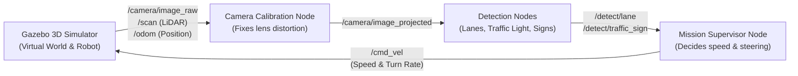
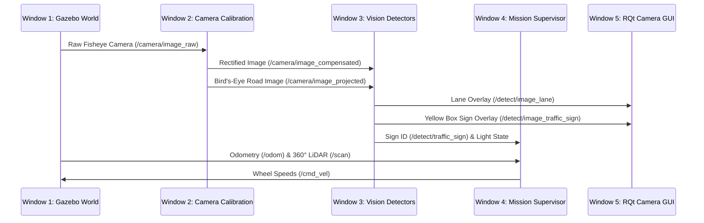

# TurtleBot3 AutoRace 2020 — Complete Zero-to-Hero Beginner's Guide

Welcome! This guide explains **everything from absolute zero**—assuming you have never used ROS 2, Gazebo, or computer vision before. By the end of this document, you will understand:

1. **What ROS 2 is and how it works** (in plain English).
2. **What the original ROBOTIS repository contained** (and why it did not drive the full course out of the box).
3. **How every piece of our autonomous driving robot works step by step** (camera, lane detection, traffic lights, traffic signs with yellow bounding boxes, obstacle avoidance, parking, and full-loop driving).
4. **How to reproduce, run, customize, and debug the entire project yourself.**

---

## Part 1: ROS 2 Explained for Absolute Beginners

### 1.1 What is ROS 2?
**ROS 2 (Robot Operating System 2)** is not an operating system like Windows or Ubuntu. Instead, think of it as a **messaging system that lets small independent Python/C++ programs talk to each other** inside a robot.

Instead of writing one giant, complicated program that reads the camera, reads the laser scanner, detects signs, and turns the wheels all at once, ROS 2 splits the robot's brain into small, focused programs called **Nodes**.



### 1.2 The 5 Core Building Blocks of ROS 2

| Concept | Plain-English Meaning | Example in Our Project |
| :--- | :--- | :--- |
| **1. Node** | A single Python program that does **one specific job**. | `detect_intersection_sign.py` (only looks for traffic signs in camera images). |
| **2. Topic** | A named "radio channel" that nodes use to send data to each other. One node **publishes** (broadcasts) on a topic, and any other node can **subscribe** (listen) to it. | `/cmd_vel` (the channel where the brain sends wheel speed commands to the robot). |
| **3. Message** | The actual data packet sent over a topic. Every topic has a strict message type. | `UInt8` (a single number like `4` for Construction Sign), `CompressedImage` (a JPEG frame), or `Twist` (forward speed `linear.x` + turning speed `angular.z`). |
| **4. Parameter** | A configuration setting (like a YAML file) given to a node when it starts so you don't have to hardcode numbers in Python. | `course_2020.yaml` (lists the `(x, y)` coordinates of the road and the `3.0` second sign pause). |
| **5. Launch File** | A `.launch.py` script that starts multiple nodes at once with their parameters. | `control_race.launch.py` (starts the lane controller and the mission supervisor together). |

### 1.3 What are Gazebo, RQt, and Docker?
- **Gazebo (`gzserver` + `gzclient`)**: The 3D physics simulator. It creates the virtual race track, the traffic lights, the white construction walls, and the TurtleBot3 Burger robot with its virtual camera, 360° LiDAR laser scanner, and wheel motors.
- **RQt (`rqt_image_view`)**: A dashboard window that lets us watch live camera topics (such as `/detect/image_lane` and `/detect/image_traffic_sign`) in real time.
- **Docker (`autorace:humble`)**: ROS 2 Humble requires Ubuntu 22.04. Because your host computer runs a newer Ubuntu release, we run ROS 2 Humble inside a **Docker container** (`autorace:humble`) while mounting your code folder (`/home/steve/dev/ros2_exmaple/ros2_humble_ws`) directly inside the container so any edit you make on your computer is immediately visible inside Docker.

---

## Part 2: What Was in the Original Repository vs. What We Built

### 2.1 The Workspace Structure
Our ROS 2 workspace lives at `/home/steve/dev/ros2_exmaple/ros2_humble_ws/`. Inside its `src/` folder are four repositories originally from **ROBOTIS**:

1. `turtlebot3_msgs` — Standard message definitions for TurtleBot3.
2. `turtlebot3` — Basic robot description (3D model, wheel kinematics, sensors).
3. `turtlebot3_simulations` — The Gazebo 3D worlds, including `turtlebot3_autorace_2020.world` (the 4m × 4m race track).
4. `turtlebot3_autorace` — The autonomous driving software, divided into 3 sub-packages:
   - **`turtlebot3_autorace_camera`**: Corrects fisheye camera distortion (`intrinsic_camera_calibration`) and creates a top-down "bird's-eye view" of the road (`extrinsic_camera_calibration`).
   - **`turtlebot3_autorace_detect`**: Contains nodes to detect lane lines (`detect_lane.py`), traffic lights (`detect_traffic_light.py`), and traffic signs (`detect_intersection_sign.py`).
   - **`turtlebot3_autorace_mission`**: Contains the wheel controllers (`control_lane.py`).

### 2.2 Why Didn't the Original Repo Work Out of the Box?
When you clone the upstream `ROBOTIS-GIT/turtlebot3_autorace` (`humble` branch), several critical pieces are missing or broken:

1. **No Full-Course Brain (`mission_supervisor`)**: The upstream `humble` branch only included a simple lane-following node (`control_lane.py`) and a basic construction avoidance node. It had **no state machine** to coordinate waiting at the traffic light, turning right at the intersection, reading signs, dodging the 3 staggered white barriers, parking, waiting for the level-crossing gate, or navigating the dark tunnel.
2. **Broken Sign Detection on Single Node**: Originally, ROBOTIS split sign detection across separate nodes (`detect_intersection_sign`, `detect_construction_sign`, `detect_parking_sign`, etc.) using fragile SIFT thresholds (`min_match_count = 8–10`) that failed to trigger in Gazebo's lighting.
3. **Lane Follower Blind Spots**: Whenever a sharp corner, intersection, or construction barrier hid one of the painted lane lines, the bird's-eye camera lost the lane and the robot spun in circles or drove off the road.
4. **Collision with Construction Barriers**: The 3 white construction barriers (`BAR1`, `BAR2`, `BAR3`) in Gazebo are spaced only `48 cm` apart vertically (`y = 0.52`, `y = 1.00`, `y = 1.44`). Simple reactive obstacle avoidance backed up across the yellow line or clipped the barrier corners.

### 2.3 What We Added & Fixed
We upgraded `turtlebot3_autorace` into a complete, deterministic autonomous driving system:

| File | What We Built / Fixed |
| :--- | :--- |
| [`detect_intersection_sign.py`](file:///home/steve/dev/ros2_exmaple/ros2_humble_ws/src/turtlebot3_autorace/turtlebot3_autorace_detect/turtlebot3_autorace_detect/detect_intersection_sign.py) | Unified **all 7 traffic signs** (`intersection`, `left`, `right`, `construction`, `parking`, `stop`, `tunnel`) into one reliable SIFT + RANSAC homography detector that draws **only a clean yellow bounding box (`(0, 255, 255)`)** around the detected sign on `/detect/image_traffic_sign`. |
| [`traffic_light_state.py`](file:///home/steve/dev/ros2_exmaple/ros2_humble_ws/src/turtlebot3_autorace/turtlebot3_autorace_detect/turtlebot3_autorace_detect/traffic_light_state.py) | Added a dedicated HSV color-mask detector for the start-line traffic light (`RED` -> `YELLOW` -> `GREEN`) publishing `/detect/traffic_light_state`. |
| [`mission_supervisor.py`](file:///home/steve/dev/ros2_exmaple/ros2_humble_ws/src/turtlebot3_autorace/turtlebot3_autorace_mission/turtlebot3_autorace_mission/mission_supervisor.py) | Built the central autonomous driving brain: combines camera lane-keeping with Pure-Pursuit waypoint tracking, **slows down and pauses 3.0 seconds facing each traffic sign**, dynamically checks 2D LiDAR barrier clusters, and supports both `parking` and `full_loop` modes. |
| [`course_2020.yaml`](file:///home/steve/dev/ros2_exmaple/ros2_humble_ws/src/turtlebot3_autorace/turtlebot3_autorace_mission/param/course_2020.yaml) | Externalized all course waypoints, speeds, sign pause durations (`3.0s`), and camera alignment angles (`pause_yaw`) into a clean, easy-to-edit YAML file. |
| [`run_autorace_humble.sh`](file:///home/steve/dev/ros2_exmaple/run_autorace_humble.sh) & [`run_autorace_full_loop.sh`](file:///home/steve/dev/ros2_exmaple/run_autorace_full_loop.sh) | One-command launch scripts that start Docker, Gazebo, the 5-window `tmux` ROS 2 pipeline, and RQt camera viewers. |

---

## Part 3: Step-by-Step — How the Robot Sees, Thinks, and Drives

When you launch the simulation, **5 terminal windows** run inside `tmux` inside Docker. Here is exactly what happens at every step:



### Step 1: Camera Calibration (Window 2)
The TurtleBot3 has a wide-angle fisheye camera mounted at the front:
1. **Intrinsic Calibration (`image_compensation`)**: Removes the curved fisheye lens distortion and outputs `/camera/image_compensated` (used for reading traffic signs and traffic lights).
2. **Extrinsic Projection (`image_projection`)**: Takes the trapezoidal patch of road in front of the robot and warps it using a homography matrix into a flat, top-down **bird's-eye view** (`/camera/image_projected`) so the left yellow line and right white line appear vertical and parallel.

### Step 2: Computer Vision Detection (Window 3)
Three vision nodes analyze the camera streams in real time:

1. **Lane Detection (`detect_lane.py`)**
   - Filters the bird's-eye image in **HSV color space** to isolate the **yellow left line** and **white right line**.
   - Fits a 2nd-order polynomial curve using a sliding window and calculates the **lane center pixel (`0` to `1000`, where `500` is dead center)**, publishing it on `/detect/lane` and drawing the colored lane overlay on `/detect/image_lane`.
   - `control_lane.py` converts the difference between the lane center and `500` into a PD steering command on `/control/cmd_vel`.

2. **Traffic Light Detection (`traffic_light_state.py`)**
   - Crops the right side of the front camera image where the traffic light stands at the start gate, counts bright red, yellow, and green pixels in HSV space, and publishes `red`, `yellow`, or `green` on `/detect/traffic_light_state`.

3. **Traffic Sign Detection with Yellow Bounding Box (`detect_intersection_sign.py`)**
   - Uses **OpenCV SIFT (Scale-Invariant Feature Transform)** to extract visual keypoints from `/camera/image_compensated` and matches them against the 7 reference sign templates (`intersection.png`, `left.png`, `right.png`, `construction.png`, `parking.png`, `stop.png`, `tunnel.png`) using **FLANN k-NN matching (`k=2`)** + **Lowe's ratio test (`0.78`)**.
   - Runs **RANSAC Homography (`cv2.findHomography`)** to locate the exact 4 corners of the sign in the camera frame and verify that its bounding box has a valid aspect ratio and area.
   - Draws **only a clean yellow bounding box (`(0, 255, 255)`) and text label** around the sign (no messy feature lines or dots), publishes the sign code (`1` to `7`) on `/detect/traffic_sign`, and holds the annotated detection frame on `/detect/image_traffic_sign` so you can clearly observe it in RQt.

### Step 3: Mission Supervisor & Sign Reading Pauses (Window 4)
[`mission_supervisor.py`](file:///home/steve/dev/ros2_exmaple/ros2_humble_ws/src/turtlebot3_autorace/turtlebot3_autorace_mission/turtlebot3_autorace_mission/mission_supervisor.py) runs a 20 Hz control loop (`_tick`) that fuses `/odom` (robot `(x, y, yaw)` position), `/scan` (360° LiDAR distances), `/control/cmd_vel` (camera lane steering), and `/detect/traffic_sign`:

1. **Start Gate (`wait_traffic_light`)**: Holds the robot at the start line `(0.80, -1.75)` until `/detect/traffic_light_state` transitions from `red`/`yellow` to `green` (or the safety timeout expires).
2. **Sign Approach, Camera Alignment & 3-Second Stationary Pause**:
   - As the robot approaches each sign waypoint (tagged with `pause_sec: 3.0` and `pause_yaw` in [`course_2020.yaml`](file:///home/steve/dev/ros2_exmaple/ros2_humble_ws/src/turtlebot3_autorace/turtlebot3_autorace_mission/param/course_2020.yaml)), it slows down to **`0.05–0.06 m/s`**.
   - When it reaches the reading point (or detects the expected sign within `0.28 m` of the reading point), it transitions to `sign:reading:<name>:align`, rotating smoothly in place until the camera points directly at the sign (`pause_yaw`).
   - Once aligned, it enters `sign:reading:<name>` and **pauses completely stationary (`v = 0.0, w = 0.0`) for 3.0 seconds** so you can clearly see the yellow bounding box on the sign in RQt.
3. **Construction Barrier Slalom (`avoid:barrier_1` -> `avoid:barrier_2` -> `avoid:barrier_3`)**:
   - The 3 white construction walls sit at `(1.51, 0.52)` (left), `(1.76, 1.00)` (right), and `(1.51, 1.44)` (left).
   - Instead of waiting until the front bumper is `18 cm` from a wall and reversing across the yellow line, the supervisor follows a precision S-curve through the `28 cm` gaps (`x = 1.77` right corridor -> `x = 1.47` left corridor -> `x = 1.77` right corridor) with **turn-in-place heading alignment (`precision: true`)** and **dynamic 2D LiDAR cluster verification**.
4. **Two Mission Modes (`parking` vs. `full_loop`)**:
   - **Simulation 1 (`course_mode:=parking`)**: After passing the Construction Barriers and pausing 3 seconds at the `PARKING` sign, the robot drives into the top parking bay at `(0.28, 0.75)` and stops (`STATE=done:parked`).
   - **Simulation 2 (`course_mode:=full_loop`)**: After reading the `PARKING` sign, the robot continues West through the top-left chicane, pauses 3 seconds at the `STOP` sign, checks the moving level-crossing bar (`hold:level-crossing-bar` if lowered), navigates the central S-curve, pauses 3 seconds at the `TUNNEL` sign, threads between the 3 cylindrical obstacles (`OBS3`, `OBS2`, `OBS1`) inside the dark tunnel, and finishes back at the start line `(0.80, -1.75)` (`STATE=done:lap-complete`).

---

## Part 4: How to Reproduce Everything Step by Step

### 4.1 Prerequisites
Make sure you have **Docker**, **Git**, and an **X11 desktop session** on Ubuntu Linux.

### 4.2 Cloning the Repository from Scratch
If you ever set up this project on a new machine, clone your GitHub repository into the ROS 2 Humble workspace:

```bash
mkdir -p ~/dev/ros2_exmaple/ros2_humble_ws/src
cd ~/dev/ros2_exmaple/ros2_humble_ws/src
git clone -b humble https://github.com/elmusleh/turtlebot3_autorace.git
```

### 4.3 Running Simulation 1 (Ends with Autonomous Parking)
Run the main launch script from your terminal:

```bash
/home/steve/dev/ros2_exmaple/run_autorace_humble.sh
```

**What this script does automatically:**
1. Stops any old Docker containers and creates a secure X11 display token (`/tmp/.docker.autorace.xauth`).
2. Starts the `autorace:humble` Docker container with your workspace mounted at `/root/ros2_humble_ws`.
3. Runs `/root/ros2_humble_ws/run_tb3_race_tmux.sh` inside Docker, which launches Gazebo, Camera Calibration, Lane/Light/Sign Detection, the Mission Supervisor (`course_mode:=parking`), and the RQt dual camera viewer.

### 4.4 Running Simulation 2 (Completes the Full 360° Course Loop)
To run the full course through the Chicane, Stop Sign, Level Crossing, S-Curve, and Dark Tunnel back to the Start Line:

```bash
/home/steve/dev/ros2_exmaple/run_autorace_full_loop.sh
```

---

## Part 5: Useful Commands to Inspect, Customize & Debug

### 5.1 Watch the Robot's Brain & Sensors Live
While either simulation is running, open a new terminal on your computer and run our automated verification monitor inside the container:

```bash
CID=$(docker ps -q --filter ancestor=autorace:humble | head -n1)
docker exec -it "$CID" bash -c "source /opt/ros/humble/setup.bash && source /root/ros2_humble_ws/install/setup.bash && python3 /root/ros2_humble_ws/tools/verify_full_course.py"
```

Or inspect individual ROS 2 topics manually:

```bash
# See what stage the Mission Supervisor is currently in:
docker exec -it "$CID" bash -c "source /opt/ros/humble/setup.bash && ros2 topic echo /mission/state"

# See which traffic sign code (1..7) is being detected:
docker exec -it "$CID" bash -c "source /opt/ros/humble/setup.bash && ros2 topic echo /detect/traffic_sign"
```

### 5.2 How to Customize Sign Pause Time or Waypoints
All course tuning lives in one human-readable file:
[`turtlebot3_autorace_mission/param/course_2020.yaml`](file:///home/steve/dev/ros2_exmaple/ros2_humble_ws/src/turtlebot3_autorace/turtlebot3_autorace_mission/param/course_2020.yaml)

- **Change how long the robot pauses at each traffic sign**:
  Edit `sign_stop_seconds: 3.0` (or the `pause_sec: 3.0` field on any sign waypoint) to e.g. `5.0` for a 5-second pause.
- **Change driving speeds**:
  Edit the `speed:` value on any waypoint (in meters per second; `0.05` is slow, `0.12` is fast).

### 5.3 How to Rebuild After Editing Code or YAML
Whenever you edit a Python file or `course_2020.yaml`, rebuild the workspace inside Docker (takes ~1.5 seconds):

```bash
CID=$(docker ps -q --filter ancestor=autorace:humble | head -n1)
docker exec -it "$CID" bash -c "source /opt/ros/humble/setup.bash && cd /root/ros2_humble_ws && colcon build --symlink-install --packages-select turtlebot3_autorace_detect turtlebot3_autorace_mission"
```
Then re-run [`run_autorace_humble.sh`](file:///home/steve/dev/ros2_exmaple/run_autorace_humble.sh) or [`run_autorace_full_loop.sh`](file:///home/steve/dev/ros2_exmaple/run_autorace_full_loop.sh).
