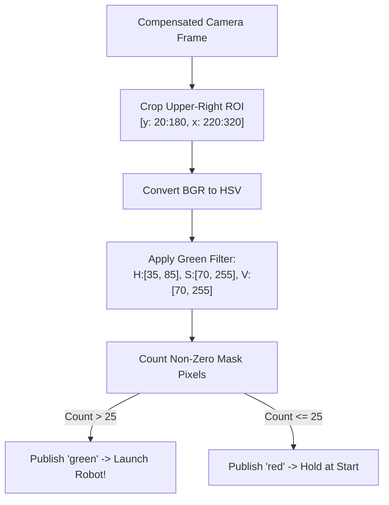
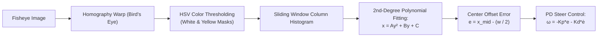
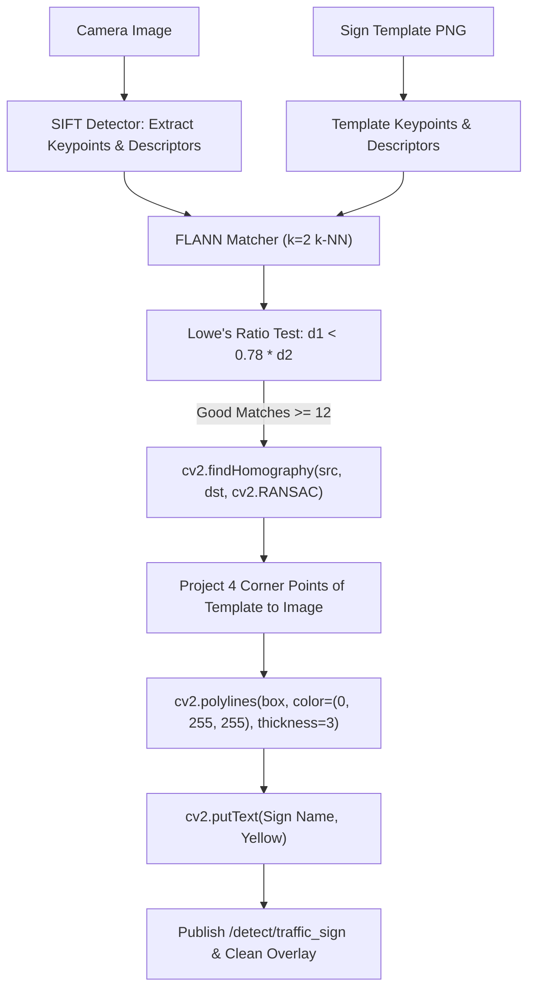

# TurtleBot3 AutoRace 2020 — Zero-to-Hero Map-Based Implementation Guide

Welcome to the comprehensive, step-by-step developer tutorial for the **TurtleBot3 AutoRace 2020** autonomous driving system in **ROS 2 Humble** and **Gazebo Classic**.

This guide is written for beginners who want to understand, build, and master everything from scratch:
- How ROS 2 coordinates sensors and actuators.
- The exact Gazebo 2D world map coordinate system `(x, y)` and headings (`yaw`).
- Task-by-task perception math (HSV masking, Inverse Perspective Mapping, SIFT feature matching + RANSAC homography).
- Control algorithms (Pure-Pursuit waypoint tracking, LiDAR obstacle avoidance).
- How to reproduce every step independently or run continuous laps.

---

## 🗺️ Master Track Map & Ground Truth Coordinate System

The AutoRace 2020 circuit is a 4.0m × 4.0m indoor miniature autonomous driving track in Gazebo. The coordinate frame is Cartesian, where:
- **Origin `(0, 0)`** is the exact center of the arena floor.
- **+X axis points East** (rightwards).
- **+Y axis points North** (upwards).
- **Heading Angle $\theta$ (`yaw`)**: $0\text{ rad}$ points East (+X), $\frac{\pi}{2}$ points North (+Y), $\pi$ points West (-X), $-\frac{\pi}{2}$ points South (-Y).

### ASCII Track Architecture Map

```text
               North (+Y)
                 ^
                 |
      [-1.5, +1.5]                 [+1.5, +1.5]
       +---------------------------------+
       |  [TASK 6]       [TASK 5]        |
       |  Level Crossing  Parking Lot    |
       |  Stop Bar &      (West: 0.25,   |
       |  Stop Sign        East: 0.75)   |
       |  (-0.80, 1.26)                  |
       |                                 |   [TASK 4]
       |  [TASK 7]                       |   Construction
West   |  Dark Tunnel                    |   Barriers (Slalom)
(-X)   |  Obstacles                      |   (1.49, 0.54)
<------+  (x: -1.75 -> -0.30)            +------> East (+X)
       |                                 |   (1.76, 1.00)
       |                                 |   (1.49, 1.44)
       |                                 |
       |                                 |   [TASK 3]
       |  [TASK 2]                       |   Traffic Signs
       |  Lane Tracking                  |   (Intersection: 1.95, -1.00)
       |  Course Loop                    |   (Right Turn: 1.08, -0.73)
       |                                 |
       |  [TASK 1]                       |
       |  Traffic Light (1.30, -1.95)    |
       |  [START LINE] (0.80, -1.75)     |
       +---------------------------------+
      [-1.5, -1.5]                 [+1.5, -1.5]
                 |
                 v
               South (-Y)
```

### Exact Gazebo Ground Truth POIs

| Zone / Asset | World $(x, y)$ | Heading ($\theta$) | Sensor Used | Target Behavior |
| :--- | :--- | :--- | :--- | :--- |
| **Start Line** | `(0.80, -1.75)` | $0.0\text{ rad}$ (East) | Odometry / Camera | Wait at start line |
| **Traffic Light** | `(1.30, -1.95)` | East-facing | Camera (Fisheye) | Red/Yellow = Halt; Green = Launch |
| **Intersection Sign** | `(1.95, -1.00)` | North-facing | Camera (SIFT + RANSAC) | Draw yellow box, decelerate, pause 3.0s |
| **Right-Turn Sign** | `(1.08, -0.73)` | East-facing | Camera (SIFT + RANSAC) | Draw yellow box, decelerate, pause 3.0s |
| **Construction Sign** | `(1.00, 0.04)` | North-facing | Camera (SIFT + RANSAC) | Draw yellow box, pause 3.0s, arm LiDAR |
| **Barrier 1 (Right)** | `(1.49, 0.54)` | World fixed | 2D LiDAR (`/scan`) | Steer left to $x \approx 1.77$ |
| **Barrier 2 (Left)** | `(1.76, 1.00)` | World fixed | 2D LiDAR (`/scan`) | Steer right to $x \approx 1.47$ |
| **Barrier 3 (Right)** | `(1.49, 1.44)` | World fixed | 2D LiDAR (`/scan`) | Steer left to exit corridor |
| **Parking Sign** | `(0.74, 1.95)` | West-facing | Camera (SIFT + RANSAC) | Draw yellow box, pause 3.0s |
| **Parking Bay 1** | `(0.25, 0.75)` | South-facing | LiDAR / Odom | Back in, pause 3.0s, reverse out |
| **Stop Sign** | `(-1.35, 1.04)` | West-facing | Camera (SIFT) | Draw yellow box, full stop 3.0s |
| **Level-Crossing Bar** | `(-0.80, 1.26)` | West-facing | 2D LiDAR (`/scan`) | Halt if distance $< 0.45\text{m}$, proceed when lifted |
| **Tunnel Sign** | `(-1.54, 0.00)` | South-facing | Camera (SIFT) | Draw yellow box, switch to LiDAR wall/cylinder follower |
| **Tunnel Obstacles** | $x \in [-1.75, -0.30]$ | Internal | 2D LiDAR (`/scan`) | Repulsive potential field navigation |

---

## 🏗️ ROS 2 Core Fundamentals: How the Robot "Thinks"

In standard non-robotic software, you might have one huge `main()` function reading sensors in a `while True:` loop. In ROS 2, every responsibility is split into **Nodes** that run independently.

```mermaid
flowchart LR
    GZ["Gazebo Simulator\n(/odom, /scan, /camera)"]
    PERC["Perception Nodes\n(Lane, Signs, Traffic Light)"]
    BRAIN["Mission Supervisor\n(State Machine & Pure Pursuit)"]
    ACT["Motors / Diff Drive\n(/cmd_vel)"]

    GZ -->|Raw Images & Point Clouds| PERC
    GZ -->|Current Pose (x, y, yaw)| BRAIN
    PERC -->|Lane Center Offset & Sign IDs| BRAIN
    BRAIN -->|Twist: linear.x, angular.z| ACT
    ACT -->|Wheel Torques| GZ
```

### The 4 Essential ROS 2 Concepts
1. **Node**: An isolated OS process executing code (e.g., `detect_intersection_sign.py`). If one node crashes, other nodes keep running.
2. **Topic**: A publish/subscribe data pipeline. Multiple nodes can listen to `/scan` without slowing down the sensor publisher.
3. **Message**: Strictly typed data structures (`geometry_msgs/msg/Twist`, `sensor_msgs/msg/LaserScan`, `sensor_msgs/msg/CompressedImage`).
4. **Parameter**: Live-reconfigurable variables loaded from `.yaml` files (e.g., `sign_stop_seconds: 3.0`).

---

## 🚀 Task-by-Task Implementation Walkthrough

---

### Task 0: Robot Coordinate Tracking & Transforms (`/odom`)

#### 1. What Happens in Gazebo
The robot publishes its dead-reckoning position on `/odom` as a `nav_msgs/msg/Odometry` message.
The orientation is given as a Quaternion: $(x, y, z, w)$.

#### 2. The Math: Quaternion to Heading Angle $\theta$
To compute steering angles, we convert Quaternion $(q_x, q_y, q_z, q_w)$ into 2D Euler Yaw:
$$\theta = \text{atan2}(2(q_w q_z + q_x q_y), 1 - 2(q_y^2 + q_z^2))$$

#### 3. How to Implement it in Python
```python
import math
from nav_msgs.msg import Odometry

def odom_callback(msg: Odometry):
    x = msg.pose.pose.position.x
    y = msg.pose.pose.position.y
    q = msg.pose.pose.orientation
    siny_cosp = 2.0 * (q.w * q.z + q.x * q.y)
    cosy_cosp = 1.0 - 2.0 * (q.y * q.y + q.z * q.z)
    yaw = math.atan2(siny_cosp, cosy_cosp)
    return x, y, yaw
```

---

### Task 1: Traffic Light Start Gate

- **Location**: `(1.30, -1.95)` (facing start line).
- **Node**: `traffic_light_state.py`.
- **Sensors**: Camera front view (`/camera/image_compensated`).



#### Step-by-Step Code Construction
1. Convert image to HSV space:
   ```python
   hsv = cv2.cvtColor(roi, cv2.COLOR_BGR2HSV)
   ```
2. Define green hue bounds:
   ```python
   lower_green = np.array([35, 70, 70])
   upper_green = np.array([85, 255, 255])
   mask_green = cv2.inRange(hsv, lower_green, upper_green)
   ```
3. Latch state in the supervisor:
   ```python
   if cv2.countNonZero(mask_green) > 25:
       self.traffic_light_cleared = True
   ```

---

### Task 2: Robust Lane Tracking & Inverse Perspective Mapping (IPM)

- **Node**: `detect_lane.py`.
- **Subscribed Topic**: `/camera/image_projected` (bird's-eye view).
- **Published Topic**: `/detect/lane` (`std_msgs/Float64` center error) and `/detect/image_lane` (HUD visualization).



#### 1. Color Segmentation
- **White Lane Markings**: Low saturation, high brightness:
  $$H \in [0, 180], \quad S \in [0, 45], \quad V \in [180, 255]$$
- **Yellow Lane Markings**:
  $$H \in [18, 38], \quad S \in [60, 255], \quad V \in [100, 255]$$

#### 2. Sliding Window Polynomial Fit
Once binary pixels are extracted:
1. Divide the bottom half of the image into horizontal slices (windows).
2. Find the peak horizontal histogram coordinate to track the lane base.
3. Fit a second-order curve $x = A y^2 + B y + C$ for both left (yellow) and right (white) lanes.
4. Calculate the track centerline: $x_{\text{center}}(y) = \frac{x_{\text{left}}(y) + x_{\text{right}}(y)}{2}$.
5. Steering angular velocity is calculated via a PD controller:
   $$\omega = -K_p \cdot e - K_d \cdot \frac{de}{dt}$$
   Where $K_p \approx 0.0035$ and $K_d \approx 0.0005$.

---

### Task 3: Traffic Sign Detection with Clean Yellow Bounding Box

- **Node**: `detect_intersection_sign.py`.
- **Target Signs**: Intersection, Turn-Right, Construction, Parking, Stop, Tunnel.
- **Goal**: Detect template signs, outline them with **only a clean yellow bounding box** (suppressing internal keypoints and dots), and command a 3.0-second pause.



#### Key Implementation Code
```python
# 1. Feature Matching with Lowe's Ratio Test
matches = flann.knnMatch(des_template, des_scene, k=2)
good_matches = [m for m, n in matches if m.distance < 0.78 * n.distance]

if len(good_matches) >= 12:
    src_pts = np.float32([kp_template[m.queryIdx].pt for m in good_matches]).reshape(-1, 1, 2)
    dst_pts = np.float32([kp_scene[m.trainIdx].pt for m in good_matches]).reshape(-1, 1, 2)

    # 2. RANSAC Homography Matrix
    M, mask = cv2.findHomography(src_pts, dst_pts, cv2.RANSAC, 5.0)
    if M is not None:
        h, w = template_img.shape[:2]
        pts = np.float32([[0, 0], [0, h - 1], [w - 1, h - 1], [w - 1, 0]]).reshape(-1, 1, 2)
        dst = cv2.perspectiveTransform(pts, M)

        # 3. Draw ONLY the Yellow Boundary Box (B=0, G=255, R=255)
        cv2.polylines(vis_img, [np.int32(dst)], isClosed=True, color=(0, 255, 255), thickness=3)
        cv2.putText(vis_img, sign_name, (int(dst[0][0][0]), int(dst[0][0][1]) - 10),
                    cv2.FONT_HERSHEY_SIMPLEX, 0.65, (0, 255, 255), 2)
```

---

### Task 4: Construction Barrier Slalom (LiDAR Avoidance)

- **Location**: East corridor: $x \in [1.38, 1.88], y \in [0.30, 1.60]$.
- **Obstacles**:
  - `barrier_1`: $(1.49, 0.54)$ (Right side)
  - `barrier_2`: $(1.76, 1.00)$ (Left side)
  - `barrier_3`: $(1.49, 1.44)$ (Right side)
- **Sensor**: 360° 2D LiDAR (`sensor_msgs/msg/LaserScan`).

```mermaid
flowchart TD
    SCAN["LiDAR Point Cloud in Front Cone (-30° to +30°)"] --> FILTER["Filter Points within 0.12m < Range < 0.75m"]
    FILTER --> CLUSTER["Cluster Points by (X, Y) Position"]
    CLUSTER --> CHECK{"Is Obstacle on Right or Left?"}
    CHECK -->|Obstacle on Right (y < 1.62)| SHIFT_L["Shift Centerline Left: target_x = 1.77m"]
    CHECK -->|Obstacle on Left (y >= 1.62)| SHIFT_R["Shift Centerline Right: target_x = 1.47m"]
    SHIFT_L & SHIFT_R --> STEER["Pure Pursuit Controller -> /cmd_vel"]
```

#### Pure Pursuit Math
To track waypoint $(g_x, g_y)$ from current pose $(x, y, \theta)$:
1. Calculate angle to target: $\alpha = \text{atan2}(g_y - y, g_x - x) - \theta$.
2. Calculate Euclidean lookahead distance: $L_d = \sqrt{(g_x - x)^2 + (g_y - y)^2}$.
3. Calculate target curvature:
   $$\kappa = \frac{2 \sin(\alpha)}{L_d}$$
4. Calculate angular velocity command:
   $$\omega = v \cdot \kappa$$

---

### Task 5: Autonomous Parking Docking

- **Location**: West Bay `(0.25, 0.75)` or East Bay `(0.75, 0.75)`.
- **Approach**:
  1. Detect Parking Sign at `(0.74, 1.95)`.
  2. Slow down and pause for 3.0 seconds.
  3. Turn South into the parking aisle `(0.50, 1.25)`.
  4. Perform 90° reverse pivot maneuver into stall `(0.25, 0.75)` using LiDAR rear clearance checking.
  5. Halt for 3.0 seconds, announce `STATE=done:parked`.
  6. *(Full-Loop mode)*: Reverse back to the aisle, turn North, and proceed to the Level Crossing.

---

### Task 6: Level Crossing & Dynamic Stop Bar

- **Location**: West track section `(-0.80, 1.26)`.
- **Obstacle**: Motorized wooden traffic barrier that alternates between down (blocking lane) and raised (open).
- **Logic**:
  1. When approaching within $0.5\text{m}$ of `(-0.80, 1.26)`, monitor LiDAR readings in the narrow forward slice:
     $$\text{dist}_{\text{front}} = \min \{ \text{scan.ranges}[\phi] \mid \phi \in [-15^\circ, +15^\circ] \}$$
  2. If $\text{dist}_{\text{front}} < 0.45\text{m}$:
     Command linear speed $v = 0.0\text{ m/s}$ (halt).
  3. Keep monitoring until $\text{dist}_{\text{front}} > 0.80\text{m}$ for 3 consecutive readings (gate fully raised).
  4. Accelerate smoothly through the railway crossing.

---

### Task 7: Dark Tunnel Navigation

- **Location**: South-West subterranean corridor: $x \in [-1.75, -0.30], y \in [-0.10, -1.50]$.
- **Condition**: Low illumination (camera lane lines can be degraded or absent).
- **Obstacles**: Cylindrical pillars scattered along the center of the tunnel.
- **Solution: LiDAR Repulsive Potential Field**:
  1. Compute wall distances from left ($+45^\circ$ to $+90^\circ$) and right ($-45^\circ$ to $-90^\circ$) LiDAR sectors:
     $$e_{\text{wall}} = d_{\text{left}} - d_{\text{right}}$$
  2. Detect pillar coordinates from front LiDAR returns:
     $$\vec{F}_{\text{repulse}} = \sum_{i} \frac{1}{d_i^2} \hat{r}_i$$
  3. Blend repulsive obstacle force with corridor centerline waypoints to navigate through the exit back to the start line `(0.80, -1.75)`.

---

## 🛠️ Step-by-Step Instructions to Build & Test

### 1. Build Packages Inside Docker
```bash
cd ~/dev/ros2_exmaple/turtlebot3_autorace
./run.sh humble build
```

### 2. Run Mode 1 (Parking Mission)
```bash
./run.sh parking
```
Monitor the mission status live:
```bash
./run.sh status
```

### 3. Run Mode 2 (Full 360° Lap)
```bash
./run.sh full-loop
```

### 4. Run Automated Headless CI Verification
```bash
./run.sh verify
```

---

## 💡 Summary of Key Files

- [`turtlebot3_autorace_mission/param/course_2020.yaml`](./turtlebot3_autorace_mission/param/course_2020.yaml): All waypoints, velocity limits, and pause times.
- [`turtlebot3_autorace_detect/detect_intersection_sign.py`](./turtlebot3_autorace_detect/turtlebot3_autorace_detect/detect_intersection_sign.py): SIFT + RANSAC yellow-box sign detector.
- [`turtlebot3_autorace_detect/detect_lane.py`](./turtlebot3_autorace_detect/turtlebot3_autorace_detect/detect_lane.py): Bird's-eye polynomial lane follower with HUD telemetry.
- [`turtlebot3_autorace_mission/mission_supervisor.py`](./turtlebot3_autorace_mission/turtlebot3_autorace_mission/mission_supervisor.py): State machine, start gate, slalom controller, and tunnel navigation.
- [`turtlebot3_autorace_mission/record_demo_video.py`](./turtlebot3_autorace_mission/turtlebot3_autorace_mission/record_demo_video.py): Records side-by-side MP4 video during runs.
